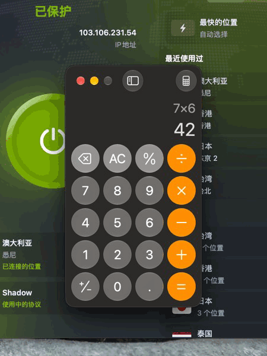

# AGY Mac Control

English | [中文](README.md)

Lets **Google Antigravity** agents see and operate apps on your Mac — while **you can watch every step and stop it with one click**.

**v2 is faster and smoother**: it reads each app's accessibility tree (indexed buttons and fields) and acts on elements directly, so most actions **don't move your mouse or steal focus**, and several steps can run in one batch. Five Calculator clicks plus a fresh read took under 1 second in testing.

> Not affiliated with Google. Antigravity's own computer-use feature isn't available to everyone yet; this is a safe, transparent stopgap until it is.

## What you see

<p align="center"></p>

<sub>Real v2 recording: the agent read Calculator's button list, then pressed AC, 7, ×, 6, = by index — the mouse never moved. Steps were slowed down for readability; overlays were temporarily made capturable and the background replaced with a solid color.</sub>

While the agent is working:

- 🪟 **A small top-right panel** with the last 3 steps and a **Stop** button (becomes **Resume** when paused)
- 🔷 **Element highlight**: the button/field being acted on flashes a blue outline — visible even though the mouse doesn't move
- ⭕ **Click ripple + smooth cursor**: only for coordinate fallback clicks

Overlays are **excluded from the agent's own screenshots** (`sharingType = .none`).

## Safety design

| Design | Why |
|---|---|
| **Permissions live in one small app** | Screen Recording and Accessibility are granted only to the menu-bar helper `AGY Mac Control`, not to Antigravity |
| **Localhost + token** | The helper listens on `127.0.0.1:47321` only; every request needs a random token (`~/Library/Application Support/agy-mac-control/token`, mode 600) |
| **One-click stop** | The panel's Stop button or a global Esc pauses everything until you resume |
| **No stale clicks** | Clicking is refused before a screenshot, and refused if the frontmost app changed since the last screenshot |
| **Sensitive apps blocked** | No clicks/typing while Passwords or Keychain Access is frontmost |
| **Audit log** | Every action is logged to `helper.log` |
| **No auto-update, no network** | Built locally from source; nothing is downloaded or sent anywhere |

## Install

Requires macOS 14+, Antigravity desktop, and Xcode Command Line Tools (`xcode-select --install`).

```bash
git clone https://github.com/nishinoya070813-a11y/agy-mac-control.git
cd agy-mac-control
./install.sh
```

Then, **yourself**, in System Settings → Privacy & Security:

1. **Accessibility**: enable "AGY Mac Control"
2. **Screen & System Audio Recording**: enable "AGY Mac Control" (use "+" to add it from Applications if it's missing)
3. Menu bar 🖱 AG → Quit, then reopen `/Applications/AGY Mac Control.app`
4. Restart Antigravity

Uninstall: `./uninstall.sh`

## Usage

Just tell Antigravity what to do, e.g. "Open Calculator and compute 1234 × 56". Antigravity asks for permission the first time the tools are used.

Tools — preferred: `computer_get_app_state`, `computer_click_element`, `computer_set_value`, `computer_element_action`; keyboard: `computer_type`, `computer_key`; batching: `computer_batch`; fallback: `computer_screenshot`, `computer_click`, `computer_drag`, `computer_scroll`, `computer_move`; misc: `computer_list_apps`, `computer_open_app`.

## Known limitations

- Main display only
- Ad-hoc signed: **re-enable both permissions after every rebuild** (the installer clears stale entries)
- Fixed port 47321
- Prefer Antigravity's official computer use once it's available to you

## Risks

This lets an AI operate your whole computer. Use it only while you're watching, never let it enter passwords or payment details, and press **Esc** the moment anything looks wrong.

## License

MIT
