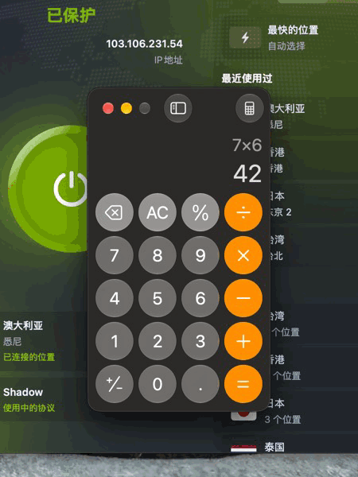

# AGY Mac Control

[English](README.en.md) | 中文

让 **Google Antigravity** 的智能体能看见并操作你 Mac 上的软件，而且**你能看清它每一步在做什么，随时一键叫停**。

**v2 更快更丝滑**：优先读软件的“辅助功能树”（按钮/输入框清单，带编号），按编号直接操作，大多数时候**不动你的鼠标、不抢前台**；还能一次连做好几步。实测在计算器上连点 5 个按钮再读结果，总共不到 1 秒。

> 非 Google 官方项目。Antigravity 自带的电脑控制功能目前还没对所有人开放，这个项目是在那之前的一个安全、透明的替代方案。

## 它长什么样

<p align="center"></p>

<sub>v1 的真实录制（全屏边框样式）：智能体在计算器上点了 AC、7、×、6、=。v2 已改为右上角小浮窗 + 元素高亮。为了录下来，演示时提示窗口临时设成了可被截图，背景也换成了纯色。</sub>

智能体操作时，屏幕上会出现：

- 🪟 **右上角小浮窗**：显示最近 3 步在做什么（如“🔘 点击「7」· 计算器”“✏️ 填写「搜索」”），带一个**“停止”按钮**，暂停后变成“继续”
- 🔷 **元素高亮**：按编号操作时，被点的按钮/输入框周围闪一圈蓝框——不动鼠标也能看清点了哪
- ⭕ **点击圆圈 + 鼠标平滑移动**：只有退回坐标点击时才会出现

这些提示**不会出现在智能体自己的截图里**（窗口设置了 `sharingType = .none`）。

## 安全设计

| 设计 | 作用 |
|---|---|
| **权限只给一个小程序** | “屏幕录制”和“辅助功能”权限只授予菜单栏小程序 `AGY Mac Control`，Antigravity 本身不需要这两个权限 |
| **只在本机通信 + 口令** | 小程序只监听 `127.0.0.1:47321`，每个请求都要带随机口令（存在 `~/Library/Application Support/agy-mac-control/token`，权限 600） |
| **一键暂停** | 点浮窗的“停止”或按 Esc，立刻拒绝一切操作，直到你点“继续” |
| **防止点错** | 按编号操作只认最近一次读到的界面；坐标操作要求先截屏，截屏后前台软件变了就拒绝 |
| **敏感软件禁区** | “密码”和“钥匙串访问”在最前面时拒绝点击和输入 |
| **操作留痕** | 每个动作记在 `helper.log` |
| **不自动更新、不联网** | 从源码本地编译，没有任何远程下载或上报 |

## 安装

需要：macOS 14+、Antigravity 桌面版、Xcode 命令行工具（`xcode-select --install`）。

```bash
git clone https://github.com/nishinoya070813-a11y/agy-mac-control.git
cd agy-mac-control
./install.sh
```

然后**你自己**在 系统设置 → 隐私与安全性 里：

1. **辅助功能**：打开「AGY Mac Control」
2. **屏幕与系统录音**：打开「AGY Mac Control」（列表里没有就点“+”从“应用程序”添加）
3. 菜单栏 🖱 AG → 退出，再重新打开 `/Applications/AGY Mac Control.app`
4. 重启 Antigravity

卸载：`./uninstall.sh`

## 使用

在 Antigravity 里直接用大白话说要做的事：

```
打开计算器，帮我算 1234 × 56
打开备忘录，新建一条写“明天 9 点交作业”
```

第一次调用时 Antigravity 会问你是否允许这些工具，可以选“在这个对话里一直允许”。

提供给智能体的工具：

| 类别 | 工具 |
|---|---|
| **首选：读界面 + 按编号操作** | `computer_get_app_state`（读按钮/输入框清单，可附窗口截图）、`computer_click_element`、`computer_set_value`、`computer_element_action` |
| **键盘** | `computer_type`、`computer_key`（可指定软件，后台发送） |
| **一次多步** | `computer_batch`（最多 20 步，可顺便返回最新界面） |
| **后备：截图 + 坐标** | `computer_screenshot`、`computer_click`、`computer_drag`、`computer_scroll`、`computer_move` |
| **其他** | `computer_list_apps`、`computer_open_app` |

## 已知限制

- 只支持主显示器
- 用的是本机临时签名：**每次重新编译后都要重新打开那两个系统权限**（安装脚本会先清掉旧记录）
- 端口固定为 47321
- Antigravity 官方的电脑控制功能开放后，建议优先用官方的

## 风险提示

这个工具能让 AI 操作你的整台电脑。请：

- 只在你看得到屏幕的时候用，别让它无人值守地跑
- 不要让它输入密码、银行卡号，不要让它付款、发消息或删除东西而不先问你
- 发现不对立刻按 **Esc**

## 原理

```
Antigravity 智能体
   │  MCP（stdio）
   ▼
mcp/mcp_server.py   —— 纯 Python 标准库，做安全检查
   │  HTTP 127.0.0.1:47321 + 口令
   ▼
AGY Mac Control.app —— Swift 菜单栏小程序，持有系统权限
   ├─ 辅助功能 API：读界面树、AXPress 按下、直接设值（不动鼠标）
   ├─ screencapture：只截目标窗口 / 后备整屏截图（缩到“点”的尺寸）
   ├─ CGEvent：后备的鼠标键盘模拟（键盘可直接发给后台软件）
   └─ 屏幕提示：右上角浮窗 / 元素高亮 / 点击圆圈
```

## 协议

MIT
